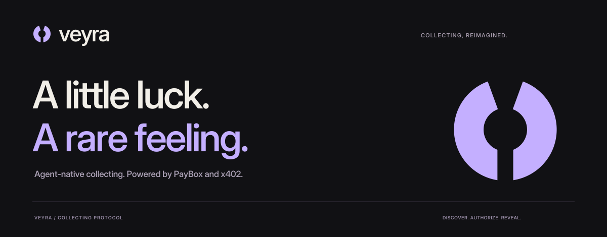

<div align="center">
  

  <p><strong>An agent-native collecting experience for PayBox.</strong></p>
  <p>Discover a pack, authorize within your limits, and keep the reveal in your personal archive.</p>

  <p>
    <a href="#quick-start">Quick start</a> ·
    <a href="#paybox-plugin">PayBox plugin</a> ·
    <a href="docs/README.md">Documentation</a> ·
    <a href="docs/BRAND.md">Brand assets</a> ·
    <a href="releases/veyra-film.mp4">Product film</a>
  </p>

  <p><code>TypeScript</code> <code>Next.js</code> <code>PayBox MCP</code> <code>x402</code> <code>Remotion</code></p>
</div>

## Overview

Veyra pairs a native PayBox plugin with a static React companion. The plugin exposes five focused tools for pack discovery, public card research, free demo reveals, and capped USDC payment proposals. The companion turns that workflow into a collecting desk with original foil packs, an animated opening, and a persistent archive.

**Project status:** the demo is functional without credentials. Live payments require a configured x402 merchant and PayBox authorization. Public card metadata does not establish physical inventory, verified grade, custody, or ownership.

### Highlights

- **Three pack identities:** First light, Afterglow, and Fireline, priced at $2, $5, and $10 USDC in the demo catalog.
- **Bounded agent behavior:** automatic demo authorization within a $10 daily allowance, or manual approval for each opening.
- **Resilient discovery:** public Pokémon TCG metadata with timeouts, bundled reference images, and source-aware USD/EUR prices.
- **A personal archive:** browser-local persistence, exportable collection data, and interactive slab previews.
- **Native payment proposals:** unsigned Base or Solana USDC requests with fixed caps and explicit expiry.
- **A shared visual language:** geometric SVG identity, CSS foil artwork, Framer Motion interactions, and a 33-second Remotion film.

## Quick start

Use Node.js 24 and npm. The PayBox plugin additionally requires pnpm **11.11.0**; its reference Node version is pinned in `plugin/.node-version`.

```sh
npm ci
npm run dev
```

Open the local URL printed by Next.js. The demo starts with 25 simulated USDC. Open a pack in agent mode to run the authorization sequence automatically, or switch to manual mode to approve it yourself.

```sh
npm run check
```

This runs TypeScript checks, behavior tests, and a production build locally. The static export is written to `out/`; `npm start` serves that export. No hosted automation is required.

## PayBox plugin

The submission artifact is **[`dist/plugin.mjs`](dist/plugin.mjs)**. Upload that file alone to the PayBox developer portal.

| Tool | Purpose | Payment behavior |
| --- | --- | --- |
| `get_setup_status` | Explain setup and optionally probe an unpaid merchant challenge | No payment |
| `list_packs` | Browse the catalog and integration readiness | No payment |
| `inspect_card` | Read public card metadata and raw-card price references | No payment |
| `open_demo_pack` | Produce a reproducible reference-card reveal | Free simulation |
| `propose_pack_purchase` | Build a capped x402 request to your configured merchant | Unsigned proposal; PayBox handles approval and execution |

Build and verify with the pinned plugin toolchain:

```sh
cd plugin
pnpm install --frozen-lockfile
pnpm test
cd ..
node scripts/publish-plugin.mjs
```

See the [submission guide](docs/SUBMISSION.md) for portal fields and the [integration guide](docs/INTEGRATION.md) for network hosts, configuration, and payment lifecycle details.

## Product film

The completed [33-second film](releases/veyra-film.mp4) is included in the repository. It uses the supplied music, a fitted 96 BPM timing grid, measured bass accents, and shared product components.

```sh
npm run video:studio
npm run video:render
```

Rendering runs locally on a machine that supports Chrome and a localhost render server. The committed analysis data makes Python optional for normal rendering. To regenerate it, install FFmpeg, NumPy, and SciPy, then run `npm run audio:analyze`.

## Documentation

| Guide | Contents |
| --- | --- |
| [Architecture](docs/ARCHITECTURE.md) | Runtime boundaries, data flow, and source layout |
| [Plugin setup](docs/PLUGIN_SETUP.md) | Required settings, discovery, and real-purchase readiness |
| [Integration](docs/INTEGRATION.md) | Merchant contract, PayBox proposals, and browser adapter |
| [Submission](docs/SUBMISSION.md) | Exact upload file, portal copy, and judging walkthrough |
| [Brand](docs/BRAND.md) | Logo assets, geometry, color, typography, and usage |
| [Validation](docs/VALIDATION.md) | Reproducible checks, verified behavior, and remaining integration work |
| [Contributing](CONTRIBUTING.md) | Local development and review expectations |
| [Changelog](CHANGELOG.md) | Notable project changes |

## Attribution

Veyra is an independent hackathon project. Pokémon, PSA, Courtyard, and PayBox names and marks belong to their respective owners. Slab artwork is a grade visualization; demo reveals grant no card, certificate, vault allocation, or shipping entitlement. Inter is distributed under the [SIL Open Font License](public/fonts/OFL.txt).
