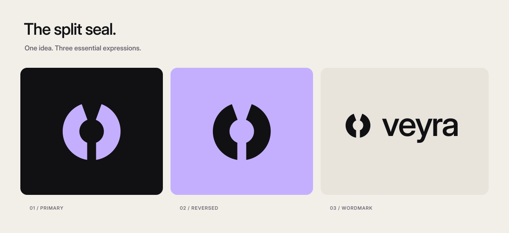

# Brand identity

[← Documentation](README.md)



**Veyra** /ˈveɪrə/ is a name for the moment an object becomes a favorite. Its voice is personal, curious, and composed. The primary line is **“A little luck. A rare feeling.”**

## The split seal

The symbol starts with a circle: a collectible, a seal, and a continuous relationship between an agent and its owner. Two cuts open that circle. The upper cut forms a subtle V; the lower cut suggests a wrapper releasing its contents.

The geometry is deliberate: a 26-unit outer radius, an 11-unit counter, mirrored halves, and an 8-unit lower opening on a 64-unit canvas. It works in one color and does not depend on a gradient, glow, or illustration. The wordmark is lowercase, with restrained spacing and outlined Inter letterforms in the exported assets.

## Assets

| Asset | Intended use |
| --- | --- |
| [Primary mark](../public/brand/mark.svg) | Violet symbol on dark backgrounds |
| [Ink mark](../public/brand/mark-ink.svg) | One-color applications on light backgrounds |
| [Paper mark](../public/brand/mark-paper.svg) | Reversed applications on dark backgrounds |
| [Wordmark](../public/brand/wordmark.svg) | Horizontal signature on dark backgrounds |
| [Ink wordmark](../public/brand/wordmark-ink.svg) | Horizontal signature on light backgrounds |
| [Transparent PNG](../public/brand/mark.png) | Raster applications at 512 × 512 |
| [Repository cover](assets/cover.svg) | README and project introduction |
| [Raster cover](assets/cover.png) | Presentations and other raster contexts |

SVG lettering is outlined, so exported wordmarks render without a font download. The editable generator is [`scripts/build_brand.py`](../scripts/build_brand.py); the interactive mark uses [`src/lib/brand.ts`](../src/lib/brand.ts).

## Color

| Token | Hex | Role |
| --- | --- | --- |
| Ink | `#111114` | Primary surface and one-color mark |
| Archive | `#19191E` | Panels and elevated surfaces |
| Paper | `#F2EFE8` | Primary type on ink |
| Foil violet | `#C4AFFF` | Primary brand accent and selected actions |
| Policy mint | `#BFDFCB` | Policy and confirmation feedback |
| First light | `#C6E9CE` | Sage pack identity |
| Fireline | `#F4BA8F` | Copper pack identity |

## Typography and spacing

Use Inter for product typography and a monospace face for compact catalog, protocol, and measurement details. Favor readable text, open space, and a clear hierarchy over decorative interface elements.

Leave at least one inner-counter radius of space around the standalone symbol. Use the mark at 20 px or larger for interface placements. Preserve the proportions of the SVGs; do not stretch, outline, shadow, or fill the negative-space cuts.

## Product expression

The three pack identities share the same composition: foil crimping, an orbital seal, edition microtype, and a clear name. Sage, violet, and copper distinguish the series without competing identities.

Motion should maintain the same sense of anticipation: establish context, focus the action, hold the reveal, and return to the seal. Interface animation uses Framer Motion. Remotion compositions use explicit frame values for reproducible exports.

## Asset generation

```sh
python3 scripts/build_brand.py
```

Requires FontTools and the bundled Inter font. PNG exports can be regenerated from the SVGs using Sharp. The font's [SIL Open Font License](../public/fonts/OFL.txt) is retained in the repository.

The project name and identity are design proposals. The project does not claim a registered trademark.
